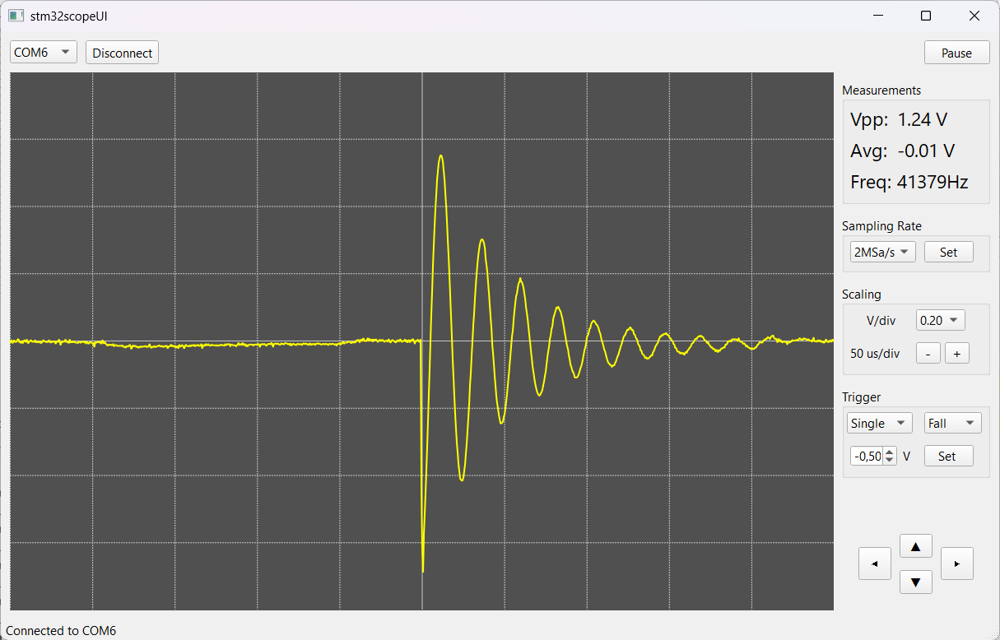

# STM32 Oscilloscope

A USB oscilloscope built around an STM32F411 microcontroller with a Qt desktop application for real-time waveform visualization and measurements. The project demonstrates high-speed ADC acquisition using DMA, trigger-based capture, and efficient USB streaming.

<div align="center">
  <a href="https://www.youtube.com/watch?v=4bzPi8Hc5ZI">
    
  </a>
</div>
</br>



## Features

* Waveform visualization with trigger support
* Voltage measurements
* Frequency measurement
* Adjustable sampling rate
* USB communication
* Max sampling speed is 2 MSa/s

## Technical Highlights

- STM32F411-based data acquisition
- Timer-triggered ADC sampling
- Continuous DMA acquisition with circular buffer
- FreeRTOS-based firmware architecture
- Trigger detection on streaming data
- Custom binary USB protocol
- Qt 6 desktop application with QCustomPlot visualization

## How it works

- An internal ADC acquires signal data and stores it in a DMA buffer, triggered by a timer. Samples are copied to a ring buffer to search for a trigger. Once trigger detected, the samples are sent to the PC via USB CDC using a binary protocol. The PC interface handles data visualization and allows configuring the trigger, sample rate, and other parameters.
- Firmware runs on FreeRTOS and separates acquisition, trigger processing and command handling into dedicated tasks.

## Hardware

| Component | Description                                  |
| --------- | -------------------------------------------- |
| MCU       | STM32F411CEU6                                |
| ADC       | Internal 12-bit ADC                          |
| Interface | USB CDC                                      |
| Input     | Analog front-end with attenuation and buffer |

## Software Architecture

```
STM32
 ├─ ADC
 ├─ DMA
 ├─ Trigger Search
 ├─ Binary Protocol
 └─ USB CDC
          │
          ▼
Qt Desktop
 ├─ SamplingDevice
 ├─ OscilloscopeCore
 └─ MainWindow with QCustomPlot Renderer
```

## Communication Protocol

* Data message: [2-byte HEADER] [1-byte MSG_TYPE] [2-byte DATA_LENGTH] [DATA] [2-byte FOOTER]
* Command request: [2-byte HEADER] [1-byte CMD_TYPE] [COMMAND_ARGS]
* Command response: [2-byte HEADER] [1-byte MSG_TYPE] [DATA]

## Repository Structure

```text
stm32_oscilloscope_project/
├── stm32scope/      # STM32firmware (Git submodule)
├── stm32scopeUI/    # Qt desktop UI application (Git submodule)
├── images/
└── README.md
```

## Building

### Clone

Whole project:
```bash
git clone --recursive https://github.com/yourname/STM32-Oscilloscope.git
```

Firmware only:
```bash
git clone https://github.com/rzynevych/stm32scope
```

Desktop UI only:
```bash
git clone https://github.com/rzynevych/stm32scopeUI
```

### Firmware

Requirements:

* STM32CubeIDE

### Desktop Application

Requirements:

* Qt 6.x
* CMake

Commands:

```bash
cd stm32scopeUI
mkdir build
cd build
cmake ..
cmake --build .
```

## Performance

| Parameter           |   Value |
| ------------------- | ------: |
| Maximum sample rate |  2 MS/s |
| USB throughput      | 12 Mbps |
| ADC resolution      |  12 bit |

## Future Improvements

* Multiple channels
* FFT
* Measurements
* Trigger improvements
* Persistent settings
* Hardware calibration

## License

- **Firmware** (`stm32scope/`) is licensed under the MIT License.
- **Desktop UI** (`stm32scopeUI/`) is licensed under the GNU General Public License v3.0 (GPL-3.0).
